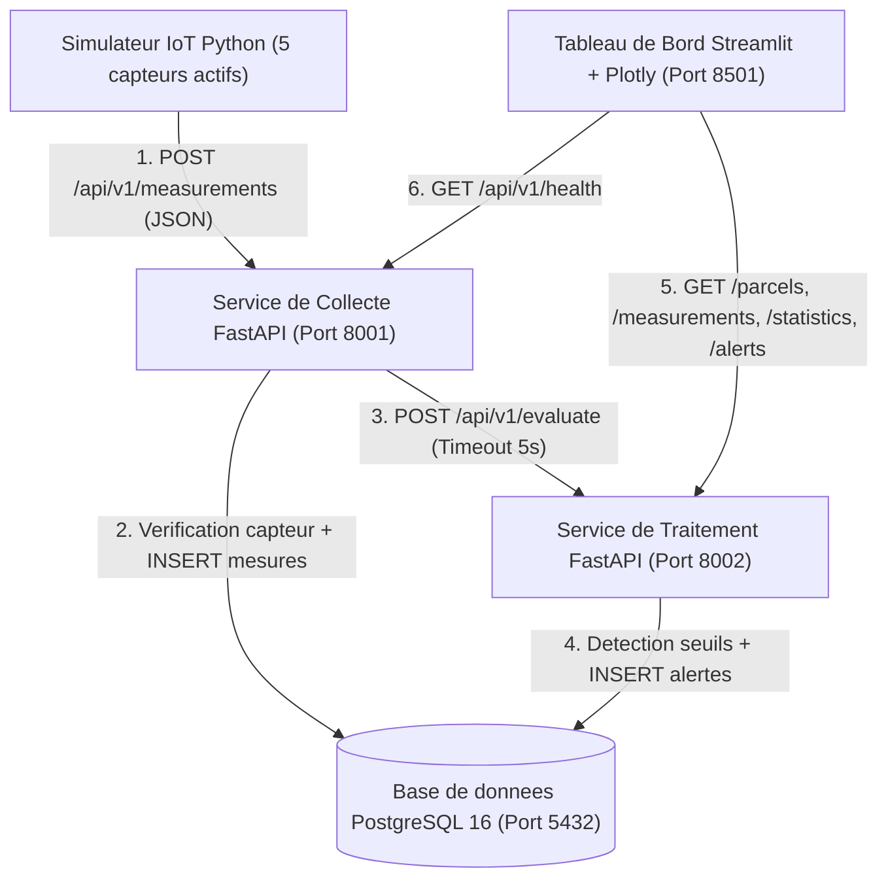
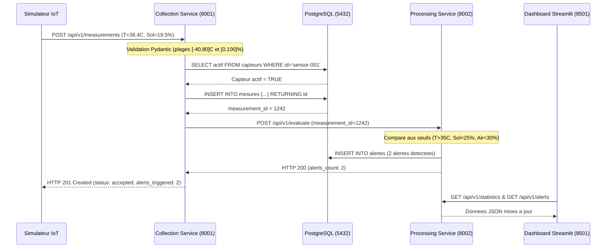
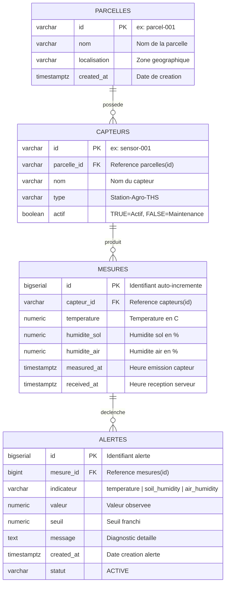

# PRD & TRD — AgriSense (Version Finale Réalisée)

## Conception et développement d'une plateforme distribuée de supervision et d'analyse des données IoT agricoles

**Version :** 2.0 (Version finale implémentée et validée)  
**Date :** Novembre 2026  
**Type de document :** Product Requirements Document (PRD), Technical Requirements Document (TRD) & Guide de Rapport / Soutenance  
**Contexte académique :** Master d'Excellence — Analytics des données et Intelligence Artificielle (ADIA)  
**Module :** Systèmes répartis et distribués  
**Dépôt GitHub :** https://github.com/meddiaby84/AgriSense  

**Membres du groupe (Trinôme) :**
- **DIABY Mohamed**
- **ELBAZ Youssef**
- **BENLAHCEN Mohamed**

---

# Partie I — PRD (Product Requirements Document)

## 1. Présentation du produit

### 1.1. Identité du produit
**AgriSense** est une plateforme logicielle distribuée destinée à collecter, valider, traiter, stocker et visualiser en temps réel des données environnementales issues de capteurs agricoles simulés répartis sur plusieurs parcelles.

### 1.2. Problématique métier et technique
Le suivi manuel des conditions agronomiques (température, humidité du sol, humidité de l'air) sur des exploitations étendues ne permet pas de détecter rapidement un stress hydrique ou un pic thermique.

Sur le plan des **systèmes répartis et distribués**, la problématique centrale résolue par AgriSense est la suivante :
> *Comment concevoir une architecture microservices découplée capable d'ingérer des flux IoT continus provenant de multiples capteurs, d'assurer la validation technique et la détection d'alertes en temps réel, tout en garantissant l'isolation des pannes, la persistance sans perte de données et la reproductibilité du déploiement ?*

### 1.3. Objectifs réalisés
1. **Simulation IoT réaliste (`simulator`)** : Simuler 5 capteurs actifs répartis sur 3 parcelles agricoles (Blé Dur, Maraîchage Tomates, Verger Agrumes) et 1 capteur en maintenance (`sensor-006`).
2. **Collecte et Validation (`collection-service`)** : Exposer une API REST (`POST /api/v1/measurements`) validant strictement le typage, les plages physiques et l'état du capteur avant stockage.
3. **Traitement Analytique et Alertes (`processing-service`)** : Calculer les indicateurs statistiques (`min`, `max`, `moyenne`) et détecter automatiquement les dépassements de seuils configurés.
4. **Persistance Relationnelle (`postgres`)** : Garantir l'intégrité référentielle entre parcelles, capteurs, mesures horodatées et alertes.
5. **Supervision Temps Réel (`dashboard`)** : Offrir une interface web moderne structurée en 4 vues métiers + une console d'injection de scénarios IoT, interrogeant exclusivement les API REST.
6. **Tolérance aux pannes & Évaluation** : Gérer les erreurs réseau (*timeouts*, *retries avec backoff*, *mode dégradé*) et mesurer les performances sous charge jusqu'à 50 clients simultanés.

---

## 2. Périmètre Fonctionnel Réalisé (MVP + Fonctionnalités Bonus)

| ID | Fonctionnalité | Description de l'implémentation | État |
|---|---|---|---|
| **F01** | Simulation des capteurs | Génération périodique (toutes les 4–5 s) de mesures JSON avec probabilité configurable (`25 %`) d'anomalie climatique | ✅ Réalisé |
| **F02** | Identification des parcelles | 3 parcelles (`parcel-001` à `003`) et 6 capteurs (`sensor-001` à `006`) rattachés par clé étrangère | ✅ Réalisé |
| **F03** | Collecte des mesures | Endpoint REST `POST /api/v1/measurements` sur le port `8001` | ✅ Réalisé |
| **F04** | Validation des données | Schéma Pydantic v2 + contrôle des plages physiques (`[-40, 80] °C`, `[0, 100] %`) + vérification capteur actif | ✅ Réalisé |
| **F05** | Stockage relationnel | Persistance dans PostgreSQL 16 avec double horodatage (`measured_at` et `received_at`) | ✅ Réalisé |
| **F06** | Analyse descriptive | Calcul dynamique de `min`, `max`, `average` et compteurs par parcelle, capteur et période | ✅ Réalisé |
| **F07** | Détection par seuils | Génération automatique d'alertes (`Température > 35 °C`, `Sol < 25 %`, `Air < 30 %`) | ✅ Réalisé |
| **F08** | Tableau de bord | Interface Streamlit + Plotly à 4 pages avec jauges circulaires, courbes *spline* et nuage de corrélation | ✅ Réalisé |
| **F09** | Consultation historique | Filtrage multicritères (parcelle, capteur, 6 fenêtres temporelles de 15 min à l'historique complet) | ✅ Réalisé |
| **F10** | Gestion des erreurs & pannes | *Timeouts*, *retries* avec *backoff* dans le simulateur, et **mode dégradé (`accepted_degraded`)** dans le collecteur | ✅ Réalisé |
| **F11** | Tests et benchmark | 12 tests automatisés (`pytest`) + script de charge asynchrone (`500` requêtes, `113 req/s`, `0 %` erreur) | ✅ Réalisé |
| **Bonus 1** | Export CSV | Téléchargement en 1 clic des mesures filtrées au format CSV depuis la page d'analyse | ✅ Réalisé |
| **Bonus 2** | Console d'injection IoT | Simulateur interactif intégré au dashboard pour tester en direct les cas d'alerte et de rejet HTTP 422/400 | ✅ Réalisé |

---

## 3. Règles Métier et Distinction Validation vs Alerte

### 3.1. Seuils agronomiques configurés (externalisés dans `.env`)

| Indicateur | Paramètre d'environnement | Seuil configuré | Interprétation métier |
|---|---|---|---|
| **Température** | `THRESHOLD_TEMPERATURE_MAX` | `> 35.0 °C` | Alerte d'excès thermique / stress de chaleur |
| **Humidité du sol** | `THRESHOLD_SOIL_HUMIDITY_MIN` | `< 25.0 %` | Alerte de stress hydrique du sol (besoin d'irrigation) |
| **Humidité de l'air** | `THRESHOLD_AIR_HUMIDITY_MIN` | `< 30.0 %` | Alerte de sécheresse atmosphérique |

### 3.2. Distinction fondamentale (Question fréquente en soutenance)
Le système distingue deux niveaux de contrôle :
1. **Validation technique (`collection-service`) — Avant stockage :**
   - Une valeur physiquement impossible (ex. `température = 145 °C` ou `humidité = -12 %`) est **rejetée immédiatement avec HTTP `422 Unprocessable Entity`** par Pydantic.
   - Un capteur inconnu (`sensor-999`) est rejeté avec **HTTP `404 Not Found`**.
   - Un capteur en maintenance (`sensor-006`, `actif = FALSE`) est rejeté avec **HTTP `400 Bad Request`**.
   - *Aucune de ces mesures invalides ne pollue la base de données.*
2. **Évaluation métier (`processing-service`) — Après stockage :**
   - Une valeur valide mais critique (ex. `température = 38.4 °C`, `humidité sol = 19.5 %`) est **acceptée (`HTTP 201 Created`)**, enregistrée dans `mesures`, puis déclenche l'insertion d'alertes dans la table `alertes`.

---

# Partie II — TRD : Architecture, Outils et Technologies par Partie

## 4. Cartographie Complète des Outils et Technologies Utilisés

| Partie du Projet | Dossier / Fichier | Technologies & Bibliothèques | Rôle précis dans AgriSense |
|---|---|---|---|
| **1. Simulateur IoT** | `simulator/app/main.py` | **Python 3.11**, `httpx` (`0.27.2`), `random`, `datetime`, `logging` | Génère les mesures JSON horodatées en UTC, simule les anomalies climatiques et envoie les requêtes HTTP POST avec *timeout* (`5s`) et *retry* à backoff progressif (`MAX_RETRIES=3`). |
| **2. Service de Collecte** | `collection-service/` | **FastAPI** (`0.115.0`), **Uvicorn** (`0.30.6`), **Pydantic v2** (`2.9.2`), **Psycopg2-binary** (`2.9.9`), **HTTPX** (`0.27.2`) | Expose `POST /api/v1/measurements` et `GET /api/v1/health`. Valide les payloads via `@field_validator`, vérifie le capteur en base, insère la mesure et appelle `processing-service` en HTTP synchrone avec repli en mode dégradé. |
| **3. Service de Traitement** | `processing-service/` | **FastAPI** (`0.115.0`), **Uvicorn**, **Pydantic v2**, **Psycopg2-binary** (`RealDictCursor`) | Expose `POST /api/v1/evaluate` et les routes `GET` (`/parcels`, `/sensors`, `/measurements`, `/alerts`, `/statistics`, `/health`). Évalue les seuils et calcule `min`, `max`, `average`. |
| **4. Base de Données** | `database/init.sql` | **PostgreSQL 16** (`postgres:16-alpine`), SQL relationnel, Index B-Tree (`idx_mesures_capteur_date`) + Repli **SQLite 3** local | Stocke les 4 tables (`parcelles`, `capteurs`, `mesures`, `alertes`) avec clés étrangères `ON DELETE CASCADE` et initialisation automatique au démarrage. |
| **5. Frontend / Dashboard** | `dashboard/app.py` | **Streamlit** (`1.39.0`), **Plotly Express & Graph Objects** (`5.24.1`), **Pandas** (`2.2.3`), **HTTPX**, **CSS3 Custom** | Interface Agritech SaaS à 4 pages (KPI cards, jauges circulaires Plotly, courbes *spline*, nuage de corrélation, export CSV, console d'injection IoT). |
| **6. Conteneurisation & Réseau** | `docker-compose.yml` | **Docker Engine**, **Docker Compose**, images `python:3.11-slim` et `postgres:16-alpine`, `pg_isready` | Isole chaque microservice dans son propre conteneur Linux, gère le réseau privé interne DNS (`http://collection-service:8000`, `http://processing-service:8000`) et le volume persistant `postgres_data`. |
| **7. Tests & Qualité** | `tests/` | **Pytest** (`8.3.3`), **Asyncio**, **HTTPX AsyncClient**, `statistics` | Exécute les tests unitaires (validation & seuils), les tests d'intégration bout-en-bout et le benchmark de charge asynchrone (jusqu'à 50 clients simultanés). |
| **8. Versionnement & Cloud** | `.gitignore`, `render.yaml` | **Git**, **GitHub**, Blueprint **Render / Railway** | Gestion des branches (`main`, `futur/backend`, `futur/frontend`), protection des secrets (`.env`) et déploiement Cloud automatisé. |

---

## 5. Diagrammes d'Architecture et de Flux

### 5.1. Diagramme d'architecture logique et flux de communication



### 5.2. Diagramme de séquence : Cycle de vie d'une mesure avec alerte



---

## 6. Modèle de Données Relationnel (`database/init.sql`)



---

## 7. Contrats d'API REST Implémentés

### 7.1. Service de Collecte (`http://localhost:8001`)

| Méthode | Route | Code Succès | Codes d'Erreur | Description |
|---|---|---|---|---|
| `POST` | `/api/v1/measurements` | `201 Created` | `400` (Inactif), `404` (Inconnu), `422` (Pydantic), `503` (DB) | Valide, stocke une mesure et déclenche l'évaluation des seuils |
| `GET` | `/api/v1/health` | `200 OK` | — | Vérifie l'état du service et la connexion PostgreSQL |

### 7.2. Service de Traitement et Consultation (`http://localhost:8002`)

| Méthode | Route | Paramètres Query | Description |
|---|---|---|---|
| `POST` | `/api/v1/evaluate` | Corps JSON | Compare une mesure aux seuils et enregistre les alertes |
| `GET` | `/api/v1/parcels` | — | Liste les parcelles avec le nombre total de capteurs et capteurs actifs |
| `GET` | `/api/v1/sensors` | `parcel_id` (opt.) | Liste les capteurs et leur état (`actif`) |
| `GET` | `/api/v1/measurements` | `parcel_id`, `sensor_id`, `period`, `limit` | Récupère l'historique filtré des mesures |
| `GET` | `/api/v1/measurements/{id}` | — | Récupère le détail d'une mesure spécifique |
| `GET` | `/api/v1/parcels/{id}/measurements` | `period`, `limit` | Récupère les mesures d'une parcelle donnée |
| `GET` | `/api/v1/alerts` | `parcel_id`, `sensor_id`, `period`, `limit` | Récupère le journal des alertes déclenchées |
| `GET` | `/api/v1/statistics` | `parcel_id`, `sensor_id`, `period` | Calcule `min`, `max`, `average`, `measurements_count` et `alerts_count` |
| `GET` | `/api/v1/health` | — | Vérifie l'état du service, la connexion DB et renvoie les seuils actifs |

---

# Partie III — Répartition du Travail (Trinôme) & Résultats Expérimentaux

## 8. Répartition des Responsabilités pour le Groupe de 3 Étudiants

| Membre du groupe | Rôle principal | Composants & Fichiers pris en charge | Ce qu'il présente à la soutenance |
|---|---|---|---|
| **1. DIABY Mohamed** | **Architecture Distribuée, Collecte IoT & Orchestration Docker** | • `simulator/` (`app/main.py`)<br>• `collection-service/` (Validation Pydantic, persistance, communication inter-services)<br>• `docker-compose.yml` & Déploiement GitHub | 1. Introduction, problématique et architecture globale des 5 conteneurs.<br>2. Fonctionnement du simulateur IoT (génération, *retries/backoff*).<br>3. Service de collecte (`8001`), validation Pydantic et tolérance aux pannes (`accepted_degraded`). |
| **2. ELBAZ Youssef** | **Modèle de Données PostgreSQL & Moteur de Traitement / Alertes** | • `database/init.sql` (Schéma relationnel, index, données initiales)<br>• `processing-service/` (Algorithme `detect_alerts`, statistiques `min/max/average`, API de consultation `8002`) | 1. Modèle relationnel PostgreSQL (4 tables et intégrité référentielle).<br>2. Algorithme de détection par seuils et distinction entre valeur invalide (HTTP 422) et alerte métier.<br>3. Calcul des indicateurs statistiques et routes REST de consultation. |
| **3. BENLAHCEN Mohamed** | **Interface de Supervision (Frontend), Tests Automatisés & Benchmark de Charge** | • `dashboard/app.py` (Streamlit + Plotly, jauges, console d'injection IoT)<br>• `tests/` (Tests unitaires, tests d'intégration, `load_test.py`)<br>• Analyse des résultats expérimentaux | 1. Démonstration en direct du Dashboard (4 pages, jauges, courbes, console d'injection IoT).<br>2. Présentation de la suite de tests (`12/12 PASSED` sous `pytest`).<br>3. Analyse du benchmark de performance (`113 req/s`, `0 %` d'erreur) et conclusion. |

---

## 9. Résultats Expérimentaux Réels

### 9.1. Validation des Tests Unitaires et d'Intégration (`12 / 12 PASSED`)
- **`collection-service/tests/test_validation.py` (`4 passed in 0.12s`)** : Validation d'une mesure nominale, rejet d'une température hors plage (`125 °C`), rejet d'une humidité négative (`-5 %`), rejet d'un identifiant capteur vide.
- **`processing-service/tests/test_processor.py` (`5 passed in 0.49s`)** : Absence d'alerte en conditions normales, détection d'alerte thermique (`38.2 °C > 35 °C`), détection multi-seuils simultanés, calcul exact de `min/max/average`, gestion d'une liste vide.
- **`tests/integration/test_integration.py` (`3 passed in 0.32s`)** : Santé des services, flux complet `POST /measurements -> PostgreSQL -> /evaluate -> GET /measurements/{id} -> GET /statistics`, et rejet `404` d'un capteur inconnu.

### 9.2. Résultats du Test de Résilience (Panne simulée)
Lors de l'arrêt volontaire du conteneur `processing-service` (`docker compose stop processing-service`), l'envoi d'une mesure à `collection-service` produit la réponse suivante :
```json
{
  "status": "accepted_degraded",
  "message": "Measurement stored, but processing-service is currently unreachable",
  "measurement_id": 1241,
  "alerts_triggered": 0,
  "alerts": []
}
```

### 9.3. Résultats du Benchmark de Performance (`tests/load_test.py`)

| Clients simultanés | Nombre de requêtes | Durée totale (s) | Temps de réponse moyen (ms) | Latence P95 (ms) | Débit mesuré (req/s) | Taux d'erreurs (%) |
|---:|---:|---:|---:|---:|---:|---:|
| **5** | 50 | 0,69 s | 63,98 ms | 92,26 ms | **72,19 req/s** | **0,0 %** |
| **10** | 100 | 0,90 s | 87,34 ms | 137,72 ms | **111,16 req/s** | **0,0 %** |
| **25** | 150 | 1,36 s | 214,77 ms | 282,43 ms | **110,63 req/s** | **0,0 %** |
| **50** | 200 | 1,76 s | 407,83 ms | 505,01 ms | **113,33 req/s** | **0,0 %** |
