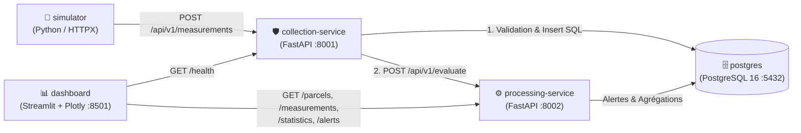

# 🌱 AgriSense — Plateforme distribuée de supervision et d'analyse des données IoT agricoles

**Contexte académique :** Master d'Excellence — Analytics des données et Intelligence Artificielle (ADIA)  
**Module :** Systèmes répartis et distribués  
**Auteur :** Mohamed DIABY (`meddiaby84`)  

AgriSense est une plateforme distribuée conteneurisée permettant de simuler des capteurs agricoles multi-parcelles, de collecter et valider leurs mesures via une API REST, de calculer des indicateurs statistiques descriptifs, de détecter des dépassements de seuils en temps réel et de visualiser l'ensemble dans un tableau de bord interactif moderne.

---

## 📌 Documentation & Livrables du dépôt

- 📄 **[Cahier des charges (PRD & TRD)](./PRD_TRD_AgriSense.md)**
- 🏗️ **[Diagrammes d'Architecture & Déploiement (Mermaid)](./docs/architecture.md)**
- 🧪 **[Résultats Expérimentaux, Résilience & Benchmark de Charge](./docs/resultats_experimentaux.md)**
- 📘 **[Rapport Technique Synthétique](./docs/rapport_technique_AgriSense.md)**

---

## 1. Architecture des Microservices (Docker Compose)



| Service | Rôle & Responsabilités | Stack | Port Hôte |
|---|---|---|---|
| `simulator` | Génère périodiquement des mesures IoT pour 5 capteurs sur 3 parcelles avec gestion de *retry/backoff* | Python 3.11, HTTPX | — |
| `collection-service` | Réceptionne (`POST /api/v1/measurements`), valide (Pydantic + existence capteur), stocke et transmet au service de traitement | FastAPI, Pydantic, Psycopg2, HTTPX | `8001` |
| `processing-service` | Évalue les seuils d'alerte (`T > 35°C`, `Sol < 25%`, `Air < 30%`), calcule les statistiques (`min`, `max`, `average`) et expose les API REST | FastAPI, Psycopg2 | `8002` |
| `postgres` | Persistance relationnelle (`parcelles`, `capteurs`, `mesures`, `alertes`) avec `healthcheck` | PostgreSQL 16 | `5432` |
| `dashboard` | Interface Agritech SaaS à 4 pages + Console d'injection IoT (consomme exclusivement les API REST) | Streamlit, Plotly, Pandas | `8501` |

---

## 2. Démarrage Rapide (Reproductible avec Docker Compose)

```bash
# 1. Cloner le dépôt
git clone https://github.com/meddiaby84/AgriSense.git
cd AgriSense

# 2. Créer le fichier d'environnement à partir du modèle
cp .env.example .env

# 3. Construire et démarrer les 5 conteneurs
docker compose up --build -d

# 4. Vérifier que tous les conteneurs sont actifs
docker compose ps
```

### 🌐 Accès aux interfaces locales
- **Tableau de bord de supervision (Streamlit) :** http://localhost:8501
- **Swagger / OpenAPI — Service de collecte :** http://localhost:8001/docs
- **Swagger / OpenAPI — Service de traitement :** http://localhost:8002/docs

*(Une option de lancement local sans Docker est également fournie via `powershell -ExecutionPolicy Bypass -File .\run_local.ps1`).*

---

## 3. Tests Automatisés & Résultats Expérimentaux

Tous les détails et traces complètes sont documentés dans [`docs/resultats_experimentaux.md`](./docs/resultats_experimentaux.md).

### 3.1. Tests unitaires et d'intégration (`12/12 PASSED`)
```bash
# Tests unitaires du service de collecte (4/4 passed)
docker exec agrisense-collection python -m pytest -v

# Tests unitaires du service de traitement (5/5 passed)
docker exec agrisense-processing python -m pytest -v

# Tests d'intégration bout-en-bout (3/3 passed)
docker cp tests/integration/test_integration.py agrisense-collection:/app/tests/test_integration.py
docker exec -e COLLECTION_SERVICE_URL=http://collection-service:8000 -e PROCESSING_SERVICE_URL=http://processing-service:8000 agrisense-collection python -m pytest -v tests/test_integration.py
```

### 3.2. Résultats du Benchmark de Charge (`tests/load_test.py`)

| Clients simultanés | Requêtes traitées | Durée (s) | Latence Moyenne (ms) | Latence P95 (ms) | Débit (req/s) | Taux d'erreurs |
|---:|---:|---:|---:|---:|---:|---:|
| **5** | 50 | 0,69 s | 63,98 ms | 92,26 ms | **72,19 req/s** | **0,0 %** |
| **10** | 100 | 0,90 s | 87,34 ms | 137,72 ms | **111,16 req/s** | **0,0 %** |
| **25** | 150 | 1,36 s | 214,77 ms | 282,43 ms | **110,63 req/s** | **0,0 %** |
| **50** | 200 | 1,76 s | 407,83 ms | 505,01 ms | **113,33 req/s** | **0,0 %** |

### 3.3. Scénario de Panne et Résilience (Section 18.3)
```bash
# 1. Arrêter le service de traitement
docker compose stop processing-service

# 2. Le service de collecte continue d'enregistrer les mesures en base en mode dégradé (HTTP 201 accepted_degraded)
# 3. Relancer le service de traitement
docker compose start processing-service
```

---

## 4. Checklist de Validation (Section 25 du PRD/TRD)

- [x] Les services sont réellement indépendants et conteneurisés.
- [x] Les échanges HTTP/REST inter-services fonctionnent et sont documentés (OpenAPI/Swagger).
- [x] Les données simulées sont reçues, validées (Pydantic) et stockées dans PostgreSQL.
- [x] Les mesures sont consultables par parcelle, capteur et période.
- [x] Les statistiques descriptives (`min`, `max`, `average`) sont calculées.
- [x] Les alertes par seuils (`Température > 35°C`, `Sol < 25%`, `Air < 30%`) sont déclenchées automatiquement.
- [x] Le tableau de bord Streamlit à 4 pages fonctionne et interroge uniquement les API REST.
- [x] Le scénario de panne d'un microservice a été testé et documenté.
- [x] Les tests unitaires et d'intégration sont disponibles et passent à 100 %.
- [x] La mesure de performance sous charge a été réalisée et interprétée.
- [x] Le déploiement est documenté et reproductible via `docker compose up --build -d`.
